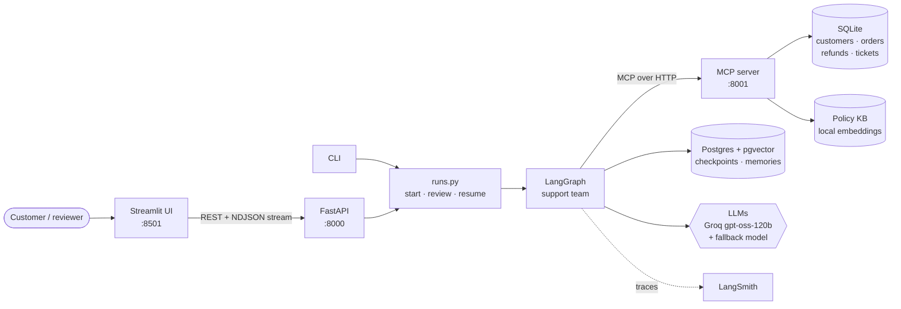
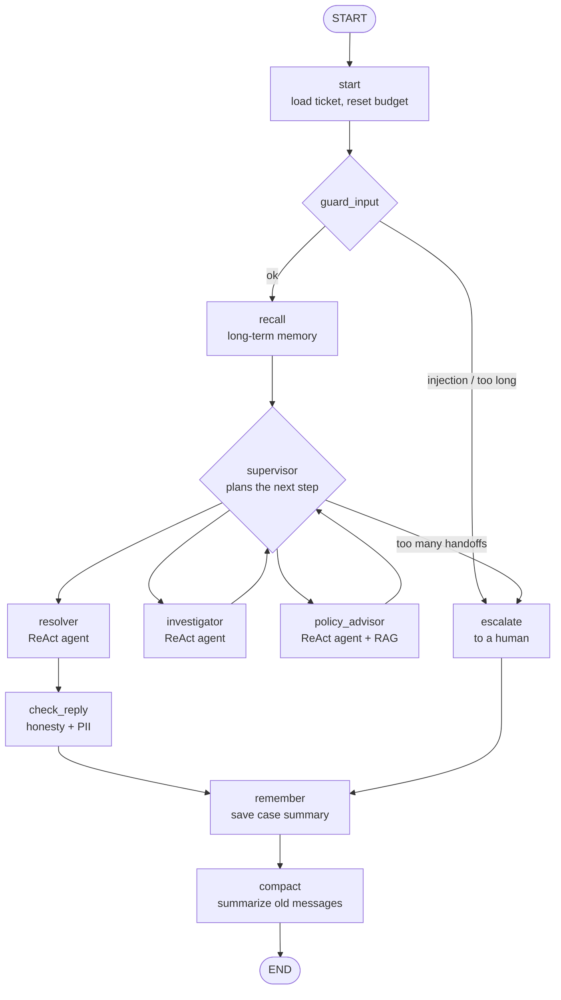
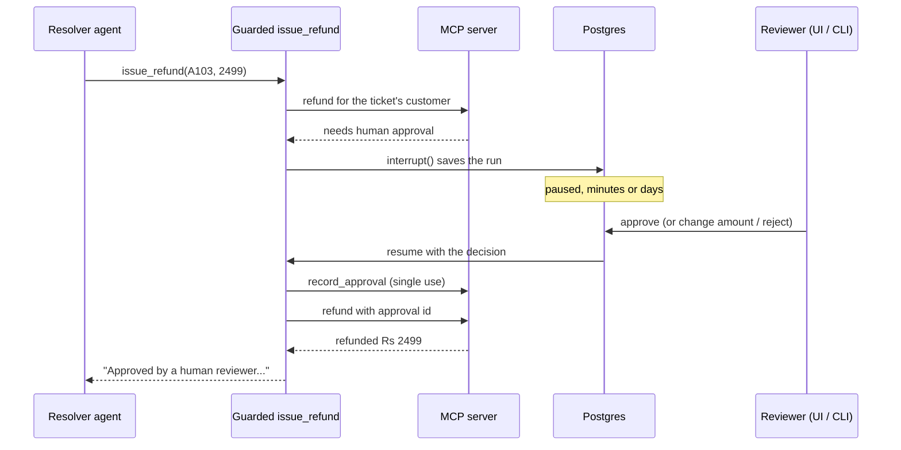

# TicketPilot

[](https://github.com/priyanshuu-x/TicketPilot/actions/workflows/ci.yml)

**A multi-agent customer-support system that resolves refund and order tickets on its own, and
stops for a human before anything risky.**

A supervisor agent plans the work and three specialist agents carry it out, using business tools
served by an **MCP server**. The system has short- and long-term memory, recovers from crashes,
guards its inputs and outputs, and is measured by an evaluation suite. It runs as four Docker
containers with CI/CD on GitHub Actions.

> Built as a capstone for "planning + tools + state + recovery + controlled autonomy, not merely
> an LLM wrapped in a while loop." The loop is written by hand first
> ([`react_loop.py`](src/ticketpilot/react_loop.py), [docs](docs/agent-loop.md)), then rebuilt
> in LangGraph.

**Contents:** [What it does](#what-it-does) · [Architecture](#architecture) ·
[The agent team](#the-agent-team) · [Human in the loop](#human-in-the-loop) ·
[Safety](#safety-layers) · [Memory](#memory) · [Evaluation](#evaluation) ·
[Run it](#run-it) · [Project structure](#project-structure) · [Design docs](#design-docs)

## What it does

A customer writes: *"My Bluetooth speaker stopped working. Can I get a refund?"*

1. The **supervisor** classifies the ticket (intent `refund`) and plans: investigator → policy
   advisor → resolver.
2. The **investigator** looks up Diya's account and finds order A103: Rs 2,499, delivered 5 days ago.
3. The **policy advisor** searches the policies (RAG) and decides a full refund is allowed, but
   above Rs 2,000 it needs human approval.
4. The **resolver** calls `issue_refund`. The run **pauses** and waits for a reviewer, with its
   state saved in Postgres.
5. A reviewer approves in the UI, possibly hours later. The run resumes, the refund is issued with
   a single-use approval, the ticket is resolved, and Diya gets a reply. The reply is checked for
   claims about actions that never happened before it's sent.

Every step streams live to the UI and is traced in LangSmith.

## Architecture



| Component | Role |
|---|---|
| **MCP server** ([`mcp_server/`](src/ticketpilot/mcp_server/)) | Owns the business data and **enforces the business rules**: refund window, refundable amount, approval for large or repeat refunds, order ownership. Agents can't bypass it. |
| **LangGraph graph** ([`agents/graph.py`](src/ticketpilot/agents/graph.py)) | The agent team: typed state, conditional routing, stopping conditions. |
| **Postgres + pgvector** | Checkpoints after every step (multi-turn tickets, crash recovery, human pauses) and long-term memories searchable by meaning. |
| **FastAPI** ([`api.py`](src/ticketpilot/api.py)) | Tickets, runs, reviews, resume, history. Runs stream one JSON event per agent step. |
| **Streamlit** ([`ui.py`](src/ticketpilot/ui.py)) | Ticket list, live step timeline, approval panel, findings, tool calls, checkpoints. |
| **LLMs** ([`llm.py`](src/ticketpilot/llm.py)) | Provider-agnostic. Each call retries with backoff, then falls back to a second model. |

## The agent team



| Agent | Tools (least privilege) | Output |
|---|---|---|
| **Supervisor** | none; structured output (`Decision`) | intent, priority, remaining plan |
| **Investigator** | `lookup_customer`, `search_orders`, `get_order` | facts: order, amount, dates, recent refunds |
| **Policy advisor** | `search_kb` (embedding search over policy rules) | decision, amount, whether approval is needed |
| **Resolver** | `issue_refund` (guarded), `update_ticket` | the action taken + the customer reply |

Each specialist is the same small ReAct loop ([`react_agent.py`](src/ticketpilot/agents/react_agent.py))
with its own tools and prompt. Specialists share **findings** (one summary each), not each other's
chat histories, which keeps every prompt small.

**Stopping conditions:** the resolver always ends a run, so every ticket gets a reply. The
supervisor is capped at `MAX_HANDOFFS` decisions, after which the ticket is escalated, and each
specialist at `MAX_STEPS` model calls.

## Human in the loop



- **The pause is in code, not in a prompt.** The resolver only has the guarded tool, and the MCP
  server rejects risky refunds without a valid approval.
- **The rules live in one place.** The guarded tool doesn't re-check "above Rs 2,000" itself; it
  tries the refund and the server decides.
- **Asynchronous.** A paused run is just saved state, so a reviewer answers from any process,
  any time later.
- **Recovery:** model calls retry with backoff and then use a fallback model; tool errors go back
  to the agent as observations; a crashed run continues from its last checkpoint (`resume`).

## Safety layers

| Layer | How |
|---|---|
| Input guard | Prompt-injection patterns and a length limit. Flagged tickets go straight to a human, and no agent sees them. |
| Least privilege | Each agent gets only the tools for its job; only the resolver can move money. |
| Authorization | The customer id comes from the ticket (run config), never from the LLM; the server checks the order belongs to them. |
| Business rules | Enforced by the MCP server, so a manipulated agent still can't break them. |
| Human approval | Refunds above Rs 2,000 or a second refund within 30 days. |
| Output check | A second model compares the reply with the tool calls that actually happened, and rewrites any unsupported claims. |
| PII | Card numbers, phone numbers and other emails are masked in replies and memories. |

## Memory

| Kind | Where | Used for |
|---|---|---|
| Short-term | Postgres checkpointer, one thread per ticket | follow-ups, history, crash recovery, human pauses |
| Context trimming | `compact` node | summarizes old messages once a conversation gets long |
| Long-term | LangGraph store + **pgvector** | one LLM-written summary per past ticket, recalled by meaning for the same customer |
| Knowledge | MCP `search_kb` | policy rules, retrieved with local `fastembed` embeddings |

## Evaluation

[`evals/run.py`](evals/run.py) runs 19 golden tickets ([`golden.json`](evals/golden.json))
through the real graph with real LLMs, including adversarial cases: prompt injection, social
engineering, refunds of someone else's order. Most metrics are read from the database and graph
state, not from the reply text.

| Metric | Result |
|---|---|
| Correct outcome (refunded / paused / refused / escalated) | **19 / 19** |
| Wrong refunds (policy violations) | **0** |
| Forbidden tool calls | **0** |
| PII leaks in replies | **0** |
| Approval precision / recall | **100% / 100%** |
| Intent accuracy | 89% |
| Reply quality, scored 1–5 by a second LLM | 4.3 / 5 |
| Latency / tokens per ticket | ~40 s / ~7,000 (Groq free tier) |

Full report: [`evals/report.md`](evals/report.md). The evals found real problems, which were fixed
in the code rather than by re-running until the numbers looked good. Those findings, and the
known open issues, are in [docs/guardrails-and-evals.md](docs/guardrails-and-evals.md).

## Tech stack

**Agents:** LangGraph, LangChain, Groq (`gpt-oss-120b`) with Gemini or `gpt-oss-20b` as fallback ·
**Tools:** Model Context Protocol (Python SDK, `FastMCP`) · **Memory:** Postgres, pgvector,
fastembed · **API / UI:** FastAPI, Streamlit · **Quality:** pytest, ruff, mypy (strict), LLM
evals, LangSmith · **Delivery:** uv, Docker (multi-stage), docker compose, GitHub Actions, GHCR

## Run it

You need [Docker](https://docs.docker.com/get-docker/) and a free
[Groq API key](https://console.groq.com/keys).

### With Docker

```bash
cp .env.example .env            # then set GROQ_API_KEY
docker compose up --build
```

Open http://localhost:8501 for the UI, or http://localhost:8000/docs for the API.

### Locally (for development)

Needs [uv](https://docs.astral.sh/uv/).

```bash
uv sync
cp .env.example .env            # then set GROQ_API_KEY
uv run pre-commit install
docker compose up -d postgres   # agent memory
```

Then start each service in its own terminal:

```bash
uv run python -m ticketpilot.mcp_server.server   # MCP server  http://127.0.0.1:8001/mcp
uv run python -m ticketpilot.api                 # API         http://127.0.0.1:8000/docs
uv run streamlit run src/ticketpilot/ui.py       # UI          http://localhost:8501
```

Or use the CLI instead of the API and UI (only the MCP server needs to run):

```bash
uv run python -m ticketpilot.cli run 3                      # the team works on ticket 3 (1-5)
uv run python -m ticketpilot.cli review 3 approve           # approve a paused refund
uv run python -m ticketpilot.cli review 3 reject -c "why"   # or reject it (--amount N to edit)
uv run python -m ticketpilot.cli run 3 -m "Any update?"     # a customer follow-up
uv run python -m ticketpilot.cli resume 3                   # finish a run that crashed
uv run python -m ticketpilot.cli history 3                  # the ticket's checkpoints
uv run python -m ticketpilot.cli memories C2                # a customer's long-term memory
```

The demo database has 3 customers, 6 orders and 5 tickets, each covering one rule: a normal
refund, outside the 30-day window, not delivered, above Rs 2,000, and a second refund within 30
days. To reset it, run `uv run python -m ticketpilot.mcp_server.db`, then `docker compose down -v`
and `docker compose up -d postgres`.

### Tests, checks and evals

```bash
uv run pytest                  # 51 tests, scripted fake LLM: no API keys, no cost
uv run ruff check . && uv run ruff format --check . && uv run mypy src
uv run python -m evals.run     # real LLMs; ~133k tokens, about one full run per day on Groq's free tier
```

CI ([`ci.yml`](.github/workflows/ci.yml)) runs the checks on every push and pull request, builds
the image, and pushes it to GHCR from `main` and version tags. Evals
([`evals.yml`](.github/workflows/evals.yml)) run on demand and weekly.

## Project structure

```
src/ticketpilot/
├── agents/
│   ├── graph.py          # the support team: state, nodes, routing, memory, guards
│   ├── react_agent.py    # one ReAct agent as a LangGraph graph (used by each specialist)
│   ├── approval.py       # guarded issue_refund: interrupt() for human approval
│   └── guardrails.py     # input check, PII redaction, reply check schema
├── mcp_server/
│   ├── server.py         # MCP tools + policy resources, business rules enforced here
│   ├── db.py             # SQLite schema + demo data
│   └── policies/         # the knowledge base (markdown)
├── api.py                # FastAPI app (streams runs as NDJSON)
├── ui.py                 # Streamlit app
├── cli.py                # command line
├── runs.py               # start / review / resume logic shared by API and CLI
├── memory.py             # Postgres checkpointer + pgvector store
├── mcp_client.py         # loads MCP tools, calls them from code
├── llm.py                # model factory with retries and fallback
├── embeddings.py         # local fastembed model
├── config.py             # all settings, from environment / .env
└── react_loop.py         # Phase 1: the agent loop written by hand, no framework
evals/                    # golden tickets, eval runner, latest report
tests/                    # 51 tests (fake LLM, in-memory MCP server)
docs/                     # design notes, one per topic
Dockerfile · docker-compose.yml · .github/workflows/
```

## Design docs

| Topic | Doc |
|---|---|
| The agent loop from first principles, and what LangGraph adds | [agent-loop.md](docs/agent-loop.md) |
| Multi-agent design: roles, routing, stopping conditions | [multi-agent.md](docs/multi-agent.md) |
| Memory: checkpoints, trimming, pgvector, RAG | [memory.md](docs/memory.md) |
| Human in the loop and recovery | [human-in-the-loop.md](docs/human-in-the-loop.md) |
| Guardrails, evals, findings and open issues | [guardrails-and-evals.md](docs/guardrails-and-evals.md) |
| API and UI | [api-and-ui.md](docs/api-and-ui.md) |
| Docker and CI/CD | [docker-and-ci.md](docs/docker-and-ci.md) |

## Limitations

- **Free-tier LLMs.** Groq allows 200k tokens per model per day, and a ticket uses ~7k. Fine for a
  demo; a real deployment needs a paid tier.
- **The data is a demo.** SQLite with synthetic customers; the MCP server's app-only tools
  (`create_ticket`, `record_approval`) would need authentication in production.
- **The injection guard is a regex.** It catches common attacks cheaply; subtler ones are stopped
  by the server-side rules, not by detection (see the `injection-social-engineering` eval case).
- **Two eval cases are still imperfect:** a reply that gives the wrong reason for refusing, and one
  that escalates when it should ask for the right order id.
